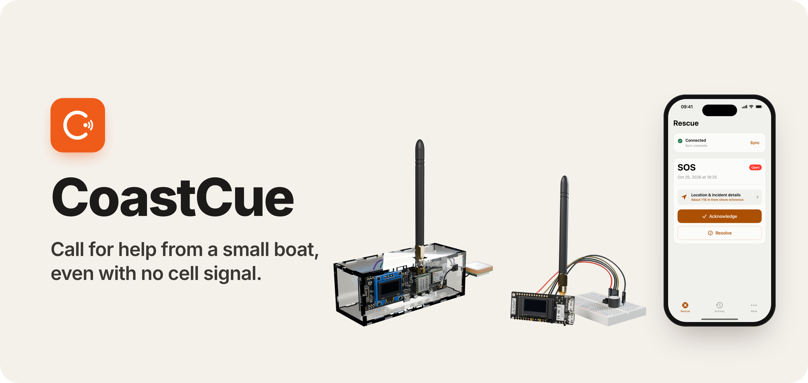
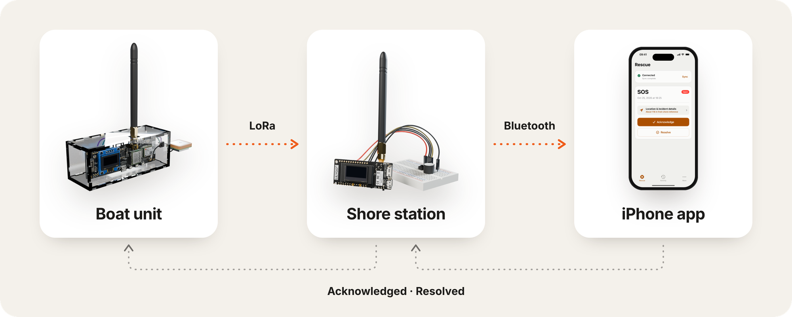
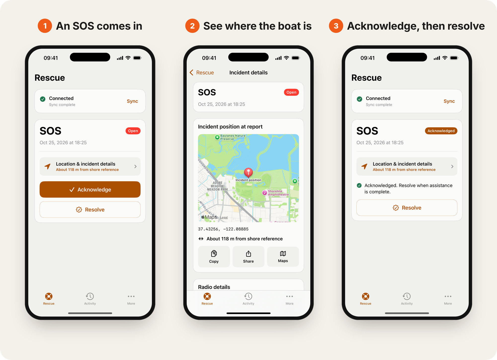

<p align="center">
  
</p>

<p align="center">
  <a href="https://www.youtube.com/watch?v=BdGoFUJRBVU"></a>
</p>

<p align="center">
  
  
  
  <a href="LICENSE"></a>
</p>

<p align="center">
  <a href="#how-it-works">How it works</a> ·
  <a href="#the-app">The app</a> ·
  <a href="#field-tests">Field tests</a> ·
  <a href="#build-it">Build it</a> ·
  <a href="docs/PROTOCOL.md">Protocol</a>
</p>

Press Help or SOS on the boat unit and it sends the boat's GPS position over
LoRa radio. The shore station sounds an alarm and shows the alert on a paired
iPhone, and the boat's screen shows when it is acknowledged and resolved.

## How it works

<p align="center">
  
</p>

Field use needs no laptop, Wi-Fi, internet or cloud account. If no phone is at
hand, the shore station's own screen and buzzer still carry the alert, and its
button can acknowledge it.

## The app

<p align="center">
  
</p>

Built with SwiftUI, Core Bluetooth and MapKit. Pairing uses the six-digit code
on the shore station's screen, and the app syncs the shore's saved history when
it reconnects.

## Field tests

<table>
  <tr>
    <td align="center" width="33%"><h3>~2.5 km</h3>full alert-to-resolution cycle at sea<br><sub>Zhoushan, China · CN 433 MHz build</sub></td>
    <td align="center" width="33%"><h3>&lt; 2 s</h3>alert to shore and phone<br><sub>Shoreline Lake, California · US 915 MHz build</sub></td>
    <td align="center" width="33%"><h3>8</h3>fishermen in our pilot<br><sub>Zhoushan, China</sub></td>
  </tr>
</table>

The [validation and early impact brief](docs/VALIDATION_AND_EARLY_IMPACT_BRIEF.md)
has the interviews and both tests.

## Hardware

| Build | Hardware | Radio |
| --- | --- | --- |
| `boat` | LilyGO T-Beam (SX1276, AXP2101), 128x64 SSD1306, button, buzzer, LEDs, acrylic case | US 915 MHz, BW500, SF9, CR4/7, 13 dBm |
| `shore` | LilyGO T3 V1.6.1 (TTGO LoRa32 V2.1_1.6), button, buzzer | same |

Pin assignments are in [`coastcue_pins.h`](ESP-32-CoastCue/pio/include/coastcue_pins.h).
The `cn` branch has the CN 433 MHz version. Check radio, antenna and US
emission rules before outdoor use; these settings are not certification.

## Build it

Needs macOS with Xcode and Python 3.

```bash
make setup    # private config + pinned PlatformIO
# set the boat ID and LoRa key in ESP-32-CoastCue/pio/include/coastcue_config.h
make check    # firmware, host and Python tests, iOS
make help     # build and flash targets
```

<details>
<summary>Flashing, the iPhone app and private config</summary>

<br>

- Flash with `make flash-<env> PORT=...`. `make devices` lists the ports, and
  the flash target checks the port before writing. US uploads also need
  `CONFIRM_US_915_UPLOAD=US_915` and verified 915 MHz hardware.
- The shore never formats its storage by itself. Run
  `make init-shore-storage PORT=... CONFIRM_STORAGE_FORMAT=ERASE CONFIRM_US_915_UPLOAD=US_915`
  only on a new or deliberately reset shore.
- The boat ID and LoRa key live only in the untracked
  `ESP-32-CoastCue/pio/include/coastcue_config.h`. The build rejects the
  placeholder key, and the upload check rejects the placeholder boat ID. Never
  commit it, serial-port names, `.pio`, `.tooling` or other build output.
- `make check` runs iOS tests when a Simulator is installed and only compiles
  them otherwise; CI always runs them. Run PlatformIO only through the Makefile.
- To install the app, open `ios/CoastCue.xcodeproj` in Xcode, choose your own
  team under Signing & Capabilities and run it on an iPhone. A free Personal
  Team's signing expires after seven days, so reinstall before a field session.

</details>

### Repository layout

```text
ESP-32-CoastCue/pio/   boat and shore firmware (PlatformIO, C++)
ios/                   iPhone app (SwiftUI)
scripts/               config, flashing and test helpers
docs/                  protocol and validation brief
```

---

<p align="center"><sub>Built by Yun Fang · <a href="LICENSE">MIT License</a></sub></p>
